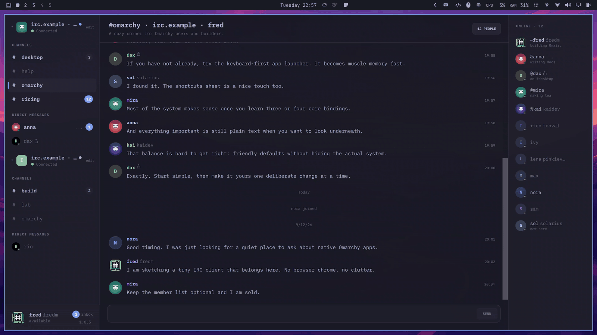

# Omairc

A simple IRC client for Omarchy. The desktop app is a Rust GPUI client in
`client/`; the same `omairc` binary is the window and a local CLI.



## Features

- Several networks in one window. Each keeps its own channels, direct messages, nick, and Status console.
- Connect sheet on first launch. Freenode, TLS on, autojoin `#omarchy`. SASL uses SCRAM-SHA-256 when the server lists it, otherwise PLAIN. EXTERNAL is not used. The NickServ password is the SASL secret when it is set; otherwise the server password is. NickServ `IDENTIFY` is sent only when SASL was not used. If the server refuses `sasl` after Omairc requests it, the connection stops with "Server rejected the SASL capability"; no `IDENTIFY` is sent.
- Member list and people count on channels. Click a nick to open a direct message. `Ctrl+W` closes it.
- Avatars, a status line, and a bot mark when the network supports them.
- Keyboard first. `Ctrl+/` lists the shortcuts.
- Slash commands from the composer, including `/list`, `/pref`, `/status`, `/avatar`, `/autoaway`, and CTCP.
- Notification for a mention or direct message while the window is unfocused.
- Colors follow the Omarchy theme and update live. Text follows the desktop size.
- Backlog on join, and recent local lines after a restart.
- ZNC playback, IRCv3 chat history, and read markers when the server offers them. ZNC and chat history behave the same in both clients; read-marker fetch is described under Limits.
- Local CLI on the running window: `connections`, `status`, `send`, `conversations`, `read`, `names`, `raise`.
- A second launch raises the existing window.

## Limits

- The saved profile stores a SASL account and a bouncer network (`account`, `bouncerNetwork`). SASL logs in as that account when it is set, otherwise the nick, and appends `/network` when a bouncer network is stored. Connect Username is the IRC `USER` name. Connect does not edit the account or the bouncer network. Saving a network keeps the stored values. A new network authenticates as the nick. Connect fields for them are [planned](https://trello.com/c/4CbyPUrR).
- ZNC playback needs `batch`. When the server also offers `znc.in/playback`, Omairc requests it and, after the message of the day, sends `ZNC *playback PLAY` from each target's stored server-time, and `ZNC *playback PLAY * 0` on every registration. A channel asks again on join until its playback batch arrives. A playback batch is backlog whenever `batch` is enabled.
- IRCv3 chat history needs `batch` plus `chathistory`, or `draft/chathistory` when `chathistory` is not available. A join uses `CHATHISTORY AFTER` the stored time, or `CHATHISTORY LATEST` when there is none. After the message of the day, open conversations catch up the same way. A direct message that arrived while away can be discovered with `CHATHISTORY TARGETS`. A closed conversation stays closed. Paging to the top loads an older page. When the server offers both `znc.in/playback` and chat history, both are requested in the same session.
- Read markers use `draft/read-marker` (`MARKREAD`), or `soju.im/read` (`READ`) when that is the only token offered. A marker from the server clears unread another client already read. This window publishes a marker when it is caught up on the selected conversation. Selecting a direct message asks the server for its marker once for that conversation until you close the direct or remove the network; later marker changes arrive through server-pushed `MARKREAD` lines. Both clients ask again after each reconnect.
- Soju network discovery is not implemented ([proposed](https://trello.com/c/800SHq4M)).
- No DCC, file transfer, voice, video, plugins, or scripts.
- The local CLI controls the running window. It is not a second IRC client.

## Install

On Omarchy edge:

```sh
omarchy pkg add omairc
```

That installs the official Omarchy package. Upgrades come with the usual Omarchy package updates.

On Omarchy stable, Omarchy rc, and other Arch-based systems:

```sh
curl -fsSL https://raw.githubusercontent.com/fredimachado/omairc/main/install.sh | sh
```

That adds the `[omairc]` pacman repository from the latest GitHub release and installs it. Re-running upgrades. Read [`install.sh`](install.sh) first if you prefer. The same script is a release asset:

```sh
curl -fsSL https://github.com/fredimachado/omairc/releases/latest/download/install.sh | sh
```

Later upgrades from that repository:

```sh
sudo pacman -Sy omairc
```

The terminal client, `omairc-tui`, ships as a separate static binary on the same GitHub release as the desktop app; `install.sh` still installs the desktop client only. The installs below need a release that carries `omairc-tui` assets, so check the [latest release](https://github.com/fredimachado/omairc/releases/latest) first.

On Linux or macOS, without a package manager:

```sh
curl -fsSL https://raw.githubusercontent.com/fredimachado/omairc/main/install-tui.sh | sh
```

That resolves the latest release, downloads the static binary for your OS and architecture, checks its version, and installs it to `~/.local/bin`. Re-running upgrades. Read [`install-tui.sh`](install-tui.sh) first if you prefer. The same script is a release asset:

```sh
curl -fsSL https://github.com/fredimachado/omairc/releases/latest/download/install-tui.sh | sh
```

Arch, once that pacman repository is configured:

```sh
sudo pacman -S omairc-tui
```

With Go 1.25 or newer. `@vX.Y.Z` is the module version; the git tag on that same commit is `tui/vX.Y.Z`:

```sh
go install github.com/fredimachado/omairc/tui/cmd/omairc-tui@vX.Y.Z
```

Homebrew, from this same tap:

```sh
brew tap fredimachado/omairc https://github.com/fredimachado/omairc
brew install fredimachado/omairc/omairc-tui
```

Scoop:

```sh
scoop bucket add omairc https://github.com/fredimachado/omairc
scoop install omairc-tui
```

Or unzip `omairc-tui-<version>-windows-amd64.zip` from the [GitHub release](https://github.com/fredimachado/omairc/releases/latest) and run `omairc-tui.exe` in Windows Terminal. Windows has no setup program for the terminal client.

From source:

```sh
git clone https://github.com/fredimachado/omairc.git
cd omairc
./bin/install
```

Run that as your user. `makepkg` calls `sudo` when it needs to.

Or install a [release package](https://github.com/fredimachado/omairc/releases/latest) directly:

```sh
sudo pacman -U omairc-<version>-1-x86_64.pkg.tar.zst
```

Depends on `fontconfig`, `freetype2`, `hicolor-icon-theme`, `libxcb`,
`libxkbcommon`, `libxkbcommon-x11`, `vulkan-icd-loader`, `wayland`, and
`xdg-desktop-portal` (see `PKGBUILD`).

Packagers build the Rust client and stage the six paths `bin/test-install`
checks (binary, desktop file, SVG, bash completion, LICENSE, OFL):

```sh
cargo build --release --locked --features product --manifest-path client/Cargo.toml
install -Dm755 client/target/release/omairc "$pkgdir/usr/bin/omairc"
```

`version.pri` is the only version string. Tag a release as `v` plus that value.

Omairc is MIT. See `LICENSE`. The bundled iA Writer Mono font is OFL-1.1.

## Agent skill

```sh
npx skills add fredimachado/omairc/skills -g
```

Installs the local CLI skill. The window must already be running.

## Build

From the repository root (default Cargo features include `product`):

```sh
cd client && cargo build --release --locked
./target/release/omairc --demo-server
./target/release/omairc --help
./target/release/omairc send --network <id> '#channel' hello
./target/release/omairc read '#channel' --since 5m
./target/release/omairc read --unread
```

On Windows:

```bat
bin\build-rust.bat
build\release\omairc.exe --demo-server
```

`--demo-server` skips Connect. `--help` and `--version` exit without a window. Quote channel targets. Control commands need a running window. With one connection, `--network` may be omitted.

Use `cargo build --features dev` when you need the separate `omairc-dev` config
tree for local experiments; release packaging always uses `product`.

## Test

```sh
bin/test
bin/test-install
bin/test-desktop
bin/test-live
```

`bin/test` is the default gate. CI also runs `bin/test-live`.

`bin/test-desktop` needs Xvfb, Xauthority, xdotool, xinput, ImageMagick,
cargo, and lavapipe; it drives the Rust release binary through
`control-omairc-desktop`. `bin/test-live` needs Docker.

## Windows

A native Windows build works. It is not the focus.

Each version tag publishes `omairc-<version>-windows-x64.zip` and `omairc-<version>-windows-x64-setup.exe` on the [GitHub release](https://github.com/fredimachado/omairc/releases/latest). The installer is per-user by default. Unzip and run `omairc.exe` for a portable tree.

```bat
bin\build-rust.bat
build\release\omairc.exe
build\release\omairc.exe --demo-server
build\release\omairc.exe --help
bin\package-windows.bat
```

`bin\build-rust.bat` builds the product client into `build\release\`.
`bin\package-windows.bat` needs Inno Setup 6.

The same exe is the local CLI. Start the window first. `--help` and control commands print from cmd or PowerShell.

Portal text scale on Linux, desktop notifications, and the Omarchy theme watch follow platform support documented in `AGENTS.md`.

## macOS

A native macOS build works. It is not the focus.

```sh
brew tap fredimachado/omairc https://github.com/fredimachado/omairc
brew install --cask fredimachado/omairc/omairc
```

The tap URL is required because this repository is not `homebrew-omairc`. That installs the app and puts `omairc` on `PATH`. The window still has to be running. `brew uninstall --cask --zap omairc` wipes profiles and logs.

Once Homebrew carries the cask:

```sh
brew install --cask omairc
```

Each version tag also publishes `omairc-<version>-macos-arm64.zip` and `omairc-<version>-macos-x64.zip` on the [GitHub release](https://github.com/fredimachado/omairc/releases/latest).

From the repo:

```sh
bin/build-macos-rust
open build/omairc.app
```

Passwords use the macOS Keychain. Profiles land in `~/Library/Preferences/omairc`.
